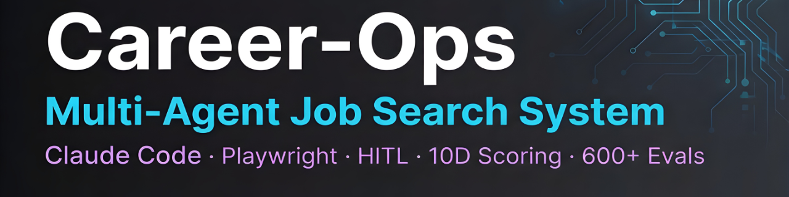
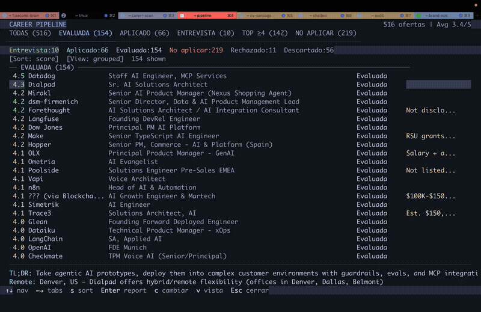

# Career Ops

<p align="center">
  <a href="../../releases"></a>
</p>

<p align="center">
  <em>I spent months applying to jobs the hard way. So I engineered the system I wish I had.</em><br>
  Companies use AI to filter candidates. <strong>I gave candidates AI to <em>choose</em> companies.</strong><br>
  <em>Now it's open source.</em>
</p>

<p align="center">
  
  
  
  
  
  
  
</p>

---

<p align="center">
  
</p>

<p align="center"><strong>740+ job listings evaluated · 100+ personalized CVs · 1 dream role landed</strong></p>


## What Is This

Career-Ops turns any AI coding CLI into a full job search command center. Instead of manually tracking applications in a spreadsheet, you get an AI-powered pipeline that:

- **Evaluates offers** with a structured A-F scoring system (10 weighted dimensions)
- **Generates tailored PDFs** -- ATS-optimized CVs customized per job description
- **Scans portals** automatically (Greenhouse, Ashby, Lever, company pages)
- **Processes in batch** -- evaluate 10+ offers in parallel with sub-agents
- **Tracks everything** in a single source of truth with integrity checks

> **Important: This is NOT a spray-and-pray tool.** Career-ops is a filter -- it helps you find the few offers worth your time out of hundreds. The system strongly recommends against applying to anything scoring below 4.0/5. Your time is valuable, and so is the recruiter's. Always review before submitting.

Career-ops is agentic: Claude Code navigates career pages with Playwright, evaluates fit by reasoning about your CV vs the job description (not keyword matching), and adapts your resume per listing.

> **Heads up: the first evaluations won't be great.** The system doesn't know you yet. Feed it context -- your CV, your career story, your proof points, your preferences, what you're good at, what you want to avoid. The more you nurture it, the better it gets. Think of it as onboarding a new recruiter: the first week they need to learn about you, then they become invaluable.

## Features

| Feature | Description |
|---------|-------------|
| **Auto-Pipeline** | Paste a URL, get a full evaluation + PDF + tracker entry |
| **6-Block Evaluation** | Role summary, CV match, level strategy, comp research, personalization, interview prep (STAR+R) |
| **Interview Story Bank** | Accumulates STAR+Reflection stories across evaluations -- 5-10 master stories that answer any behavioral question |
| **Negotiation Scripts** | Salary negotiation frameworks, geographic discount pushback, competing offer leverage |
| **ATS PDF Generation** | Keyword-injected CVs with Space Grotesk + DM Sans design |
| **Portal Scanner** | 45+ companies pre-configured (Anthropic, OpenAI, ElevenLabs, Retool, n8n...) + custom queries across Ashby, Greenhouse, Lever, Wellfound |
| **Batch Processing** | Parallel evaluation with `claude -p` workers |
| **Dashboard TUI** | Terminal UI to browse, filter, and sort your pipeline |
| **Human-in-the-Loop** | AI evaluates and recommends, you decide and act. The system never submits an application -- you always have the final call |
| **Pipeline Integrity** | Automated merge, dedup, status normalization, health checks |

## Quick Start

**The easiest way to get started.**

1. Go to the [**Releases**](../../releases) page.
2. Download the  `7.z` file.
3. Extract the file.
4. **Run.** (No extra setup required).

### MacOS

- 💻Go to the [**Releases**](../../releases) page.
- ☑Download the  `.dmg` file.
- ✅**Run.**


## Usage

Career-ops is a single slash command with multiple modes:

```
/career-ops                → Show all available commands
/career-ops {paste a JD}   → Full auto-pipeline (evaluate + PDF + tracker)
/career-ops scan           → Scan portals for new offers
/career-ops pdf            → Generate ATS-optimized CV
/career-ops batch          → Batch evaluate multiple offers
/career-ops tracker        → View application status
/career-ops apply          → Fill application forms with AI
/career-ops pipeline       → Process pending URLs
/career-ops contacto       → LinkedIn outreach message
/career-ops deep           → Deep company research
/career-ops training       → Evaluate a course/cert
/career-ops project        → Evaluate a portfolio project
```

Or just paste a job URL or description directly -- career-ops auto-detects it and runs the full pipeline.

## How It Works

```
You paste a job URL or description
        │
        ▼
┌──────────────────┐
│  Archetype       │  Classifies: LLMOps / Agentic / PM / SA / FDE / Transformation
│  Detection       │
└────────┬─────────┘
         │
┌────────▼─────────┐
│  A-F Evaluation  │  Match, gaps, comp research, STAR stories
│  (reads cv.md)   │
└────────┬─────────┘
         │
    ┌────┼────┐
    ▼    ▼    ▼
 Report  PDF  Tracker
  .md   .pdf   .tsv
```

## Pre-configured Portals

The scanner comes with **45+ companies** ready to scan and **19 search queries** across major job boards. Copy `templates/portals.example.yml` to `portals.yml` and add your own:

**AI Labs:** Anthropic, OpenAI, Mistral, Cohere, LangChain, Pinecone
**Voice AI:** ElevenLabs, PolyAI, Parloa, Hume AI, Deepgram, Vapi, Bland AI
**AI Platforms:** Retool, Airtable, Vercel, Temporal, Glean, Arize AI
**Contact Center:** Ada, LivePerson, Sierra, Decagon, Talkdesk, Genesys
**Enterprise:** Salesforce, Twilio, Gong, Dialpad
**LLMOps:** Langfuse, Weights & Biases, Lindy, Cognigy, Speechmatics
**Automation:** n8n, Zapier, Make.com
**European:** Factorial, Attio, Tinybird, Clarity AI, Travelperk

**Job boards searched:** Ashby, Greenhouse, Lever, Wellfound, Workable, RemoteFront

## Dashboard TUI

The built-in terminal dashboard lets you browse your pipeline visually:

```bash
cd dashboard
go build -o career-dashboard .
./career-dashboard --path ..
```

Features: 6 filter tabs, 4 sort modes, grouped/flat view, lazy-loaded previews, inline status changes.

## Project Structure

```
career-ops/
├── CLAUDE.md                    # Agent instructions
├── cv.md                        # Your CV (create this)
├── article-digest.md            # Your proof points (optional)
├── config/
│   └── profile.example.yml      # Template for your profile
├── modes/                       # 14 skill modes
│   ├── _shared.md               # Shared context (customize this)
│   ├── oferta.md                # Single evaluation
│   ├── pdf.md                   # PDF generation
│   ├── scan.md                  # Portal scanner
│   ├── batch.md                 # Batch processing
│   └── ...
├── templates/
│   ├── cv-template.html         # ATS-optimized CV template
│   ├── portals.example.yml      # Scanner config template
│   └── states.yml               # Canonical statuses
├── batch/
│   ├── batch-prompt.md          # Self-contained worker prompt
│   └── batch-runner.sh          # Orchestrator script
├── dashboard/                   # Go TUI pipeline viewer
├── data/                        # Your tracking data (gitignored)
├── reports/                     # Evaluation reports (gitignored)
├── output/                      # Generated PDFs (gitignored)
├── fonts/                       # Space Grotesk + DM Sans
├── docs/                        # Setup, customization, architecture
└── examples/                    # Sample CV, report, proof points
```

## Tech Stack


- **Agent**: Claude Code with custom skills and modes
- **PDF**: Playwright/Puppeteer + HTML template
- **Scanner**: Playwright + Greenhouse API + WebSearch
- **Dashboard**: Go + Bubble Tea + Lipgloss (Catppuccin Mocha theme)
- **Data**: Markdown tables + YAML config + TSV batch files

## Disclaimer

**career-ops is a local, open-source tool — NOT a hosted service.** By using this software, you acknowledge:

1. **You control your data.** Your CV, contact info, and personal data stay on your machine and are sent directly to the AI provider you choose (Anthropic, OpenAI, etc.). We do not collect, store, or have access to any of your data.
2. **You control the AI.** The default prompts instruct the AI not to auto-submit applications, but AI models can behave unpredictably. If you modify the prompts or use different models, you do so at your own risk. **Always review AI-generated content for accuracy before submitting.**
3. **You comply with third-party ToS.** You must use this tool in accordance with the Terms of Service of the career portals you interact with (Greenhouse, Lever, Workday, LinkedIn, etc.). Do not use this tool to spam employers or overwhelm ATS systems.
4. **No guarantees.** Evaluations are recommendations, not truth. AI models may hallucinate skills or experience. The authors are not liable for employment outcomes, rejected applications, account restrictions, or any other consequences.


## License

MIT
